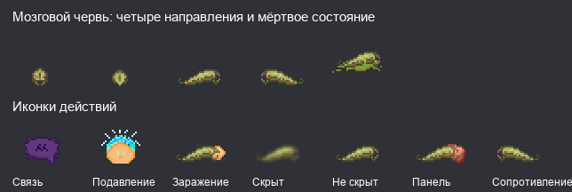

# Мозговые черви: административный прототип

Порт игрового цикла из [ss220-space/Paradise](https://github.com/ss220-space/Paradise/tree/d68d62a930207a2ea4ada333d61cad2024856053), адаптированный к mind, basic mobs, хирургии и TGUI BandaStation. Первых бореров создаёт администратор; автоматического события и roundstart-роли нет. Рождённые личинки доступны призракам через стандартный опрос с проверкой запрета на роль traitor.

## Быстрый запуск

1. Собрать проект обычным `BUILD.cmd`, включая TGUI. Либо запустить подготовленный отдельный `tgstation.borer-prototype.dmb` в Dream Daemon; основной `tgstation.dmb` в ходе разработки не перезаписывается.
2. Начать раунд. В административной панели создания мобов создать `/mob/living/basic/cortical_borer` рядом с живым органическим гуманоидом с органическим мозгом.
3. Передать борера игроку стандартным административным Possess / изменением `key` через VV. Роль выдаётся при входе игрока в моба. Начальные бореры сами не предлагают себя призракам.
4. Использовать кнопки «Подавить жертву» и «Заразить носителя», затем «Панель мозгового червя». «Прятаться под мебелью» — отдельная переключаемая кнопка: червь опускается ниже столов и перестаёт подниматься на их поверхность. Заражение выключает этот режим.
5. Для удобства закрытого теста администратор может через VV установить `chemicals = 250` и `evolution_points = 30`. Это административная подготовка теста, не игроковая возможность.

Подготовленный DMB лежит в корне рабочей копии и игнорируется Git; он не заменяет сборку из исходников на тестовом сервере. При изменении кода его нужно пересобрать.

## Как играть

- Вне носителя борер проходит под столами, ползает по вентиляции и может прятаться ниже мебели отдельной кнопкой. Используется исходный `brainslug` Paradise, уменьшенный для молодого ранга.
- Подавление сбивает гуманоида с ног на 6 секунд в радиусе трёх клеток; перезарядка — 30 секунд. Заражение соседнего носителя занимает 5 секунд и прерывается его перемещением.
- Внутри носителя обычный Say борера отправляет частное сообщение. В панели есть общая связь бореров, анализ здоровья, химия и принудительная речь носителя. Кнопка «Связаться с паразитом» появляется у носителя только после первого успешно отправленного ему личного сообщения червя. Отмена ввода, пустое сообщение и общий канал бореров связь не открывают. При выходе связь сбрасывается, в том числе перед повторным заражением того же носителя.
- Полный контроль устанавливается за 30 секунд плюс 0.5 секунды за единицу повреждения мозга. Движение носителя не прерывает внутреннюю настройку связи. Mindshield не защищает от контроля.
- Во время контроля игрок носителя получает временный моб с кнопкой сопротивления и, если связь уже открыта, кнопкой общения. Первое сообщение червя во время контроля также открывает ответ пленённому разуму. Сопротивление занимает 35–45 секунд плюс повреждение мозга в децисекундах и возвращает управление ценой 5–10 урона мозгу. Агония может прервать текущую попытку, но следующая доступна сразу; у агонии перезарядка 10 секунд и расход ресурса.
- Возврат управления и выход — разные действия. Покидание тела занимает 20 секунд; перед выходом управление возвращается владельцу. Можно выйти и из умершего носителя. Носитель не умирает от самого отсоединения.
- Сахар в крови блокирует способности; полный контроль прекращается на ближайшем тике жизни. Борер может общаться с носителем через Say, пока ослаблен, но активные способности недоступны.
- Размножение доступно при полном контроле за 100 ресурса: появляется личинка, выдаётся одно очко развития. Фокус размножения снижает цену до 30 и даёт шанс дополнительных личинок. Общего ограничения популяции в прототипе нет.
- Ранги Young → Mature → Adult → Elder требуют последовательно 3, 6 и 10 размножений: всего 19. Фокусы сохраняют дробные цены Paradise; интерфейс показывает цену покупки.
- Ресурс растёт на 0.5 в секунду в живом носителе; секреция даёт ещё 0.25, старшие ранги — ещё 0.1. Новый уникальный носитель с клиентом увеличивает ёмкость на 15 до предела 355.
- Все восемь фокусов доступны в панели. Бонус за кататоничного носителя фиксируется при входе и снимается по тому же коэффициенту независимо от последующего SSD/reconnect.

## Противодействие и медицина

Другой мозговой червь, xeno host, blood worm и занятое временное тело исключают заражение/контроль. Для заражения нужны голова и органический мозг; синтетические носители не подходят. Чужая роль остаётся за оригинальным mind.

По согласованному ограничению прототипа полный контроль культистов отключён; пассивное заражение, общение и помощь доступны. Причина: `code/modules/antagonists/cult/datums/cultist.dm`, `apply_innate_effects()` и `remove_innate_effects()` выбирают `owner.current` раньше `mob_override`, хотя при переносе mind обработчику передаётся прежнее тело. Этот общий дефект оставлен отдельной задачей; код культа не менялся. Сам разум борера имеет стандартный `TRAIT_UNCONVERTABLE`, в том числе в управляемом теле.

Медицинский HUD показывает существующий общий индикатор `hudill3` при полном контроле, если более приоритетное медицинское состояние не заняло этот слот. Специального индикатора борера на медицинском HUD пока нет. Обычное пассивное заражение на HUD не раскрывается. Сканер сообщает об отклонениях при полном контроле; сокрытие относится только к HUD.

Скрыть HUD можно за 50 ресурса, если у пленённого mind нет активного игрока. Это останавливает накопление ресурса; возврат управления отключает сокрытие.

Для извлечения: подготовить голову по обычным правилам хирургии (открытая кожа, разрезанные внутренние ткани и распиленная кость), затем выбрать гемостатом «Извлечение мозгового червя». Извлечение мозга также выводит борера и возвращает оригинальный mind до переноса личности в извлечённый мозг. Смерть носителя прекращает контроль; удаление тела выводит паразита, а игрока исчезнувшего тела освобождает в призрака.

## Химия и отличия от Paradise

Все варианты проверяются на сервере. Дозы существующих реагентов — 5 единиц; пауза между применениями — 1 секунда. Условия и цены видны в панели. При управлении телом секреция недоступна. Повторные дозы складываются и могут вызвать местные передозировки.

Сохраняются местные Mannitol, Epinephrine, Salbutamol, Spaceacillin, Saline-glucose, Methamphetamine и Insulin. Инсулин требует 50 ресурса; он не обходит подавление уже присутствующим сахаром.

| Отсутствующий реагент Paradise | Замена прототипа | Существенное отличие |
| --- | --- | --- |
| Charcoal | 5 ед. Multiver | Местная механика очистки; возможен урон лёгким, это не безопасная копия угля |
| Hydrocodone | 5 ед. Miner's Salve | Местная аналгезия, небольшое лечение и ложное ощущение полного здоровья на личном HUD |
| Mitocholide | Прямое восстановление 5 урона органических внутренних органов, кроме мозга | Однократный эффект, а не реагент; не создаёт отсутствующие органы |
| Fliptonium | Вращение на 5 секунд | Визуальный эффект, не оглушение и не метаболизируемое вещество |
| Capulettium Plus | Ложная смерть и немота на 20 секунд | Местный временный status effect, без вещества в крови |

Руки дают +5 к обеим границам урона текущих рук и ускоряют инструменты: коэффициенты Paradise не копируются в общий species datum. После ампутации бонус остаётся на изменённой руке до выхода борера, после чего снимается; заменённые руки автоматически не усиливаются. Жало добавляет фиксированные 5 секунд вместо случайных 5–6. Точные интервалы регенерации и ресурса заданы в секундах, а не тиках Paradise.

Обычная речь носителя соблюдает его физические ограничения и муты. Частные сообщения проходят фильтр и защиту от спама. Телепатия пока текстовая; существующий TTS-голос борера сохранён для обычной речи снаружи.

## Проверки

Автотесты: `cortical_borer_actions`, `cortical_borer_hiding`, `cortical_borer_contact`, `cortical_borer_control`, `cortical_borer_control_ssd`, `cortical_borer_control_ui`, `cortical_borer_validation`, `cortical_borer_focus_cleanup`, `cortical_borer_brain_removal`, `cortical_borer_emergency_release`, `cortical_borer_external_transfer`, `cortical_borer_host_deletion`, `cortical_borer_reproduction`, `cortical_borer_cult_guard`. Подключены внутри штатного блока unit tests; фокусировка для локального прогона не добавляется в исходники модуля.

Для ручного теста нужны два клиента. Проверить заражение и отмену, общение, полный контроль и сопротивление, сахар, выход при движущемся и умершем носителе, рождение/занятие личинки, каждое улучшение и его снятие, медицинский HUD/сканер/операцию, отключение и возвращение обоих клиентов. Отдельно проверить снятие роли администратором и удаление борера при контроле.

Регрессия SSD/панели: взять полный контроль, подождать не менее 10 секунд и проверить, что пустое тело червя не получает SSD-сон, а панель управляемого носителя позволяет анализ здоровья и связь. Затем усыпить именно носителя: панель должна перейти в режим просмотра, способности — заблокироваться. После возврата управления обычный сон снова ограничивает действия самого червя. Во время контроля сознание для панели проверяется по управляемому телу; химия по-прежнему доступна только при сосуществовании.

Регрессия кнопок/спрайтов: при первом Possess и повторном входе «Заразить носителя» и «Подавить жертву» должны иметь картинки и обычный цвет; подавление краснеет на настоящей перезарядке. Включить отдельное скрытие, проползти под обычным столом: червь рисуется ниже столешницы и не поднимается на неё; выключение восстанавливает обычный слой и подъём. До первого сообщения у носителя нет кнопки связи; отмена ввода и общий канал её не дают. После личного сообщения проверить ответ, захват/возврат тела и сброс связи после выхода и нового заражения.

Перед общим тестмержем: проверить роль с прочими антагонистами и post-ghost reentry, удобство временного HUD пленённого игрока, баланс агонии и роста популяции. Наличие компиляции и unit tests не заменяет двухклиентный прогон.

Результат локальной проверки 26 октября 2026 года:

- Игровой `tgstation.borer-prototype.dmb`: 0 ошибок, 0 предупреждений.
- Все четырнадцать перечисленных unit tests: PASS, включая регрессии SSD-сна, панели, цветов кнопок, скрытия под столом и первого контакта с носителем. Финальный прогон `borer-actions-tests-final` создал `clean_run.lk` с `Success!`, без runtimes. Четыре предупреждения тестовой компиляции относятся к reference tracking, отключённым loop checks и двум локальным переменным штатного test runner.
- Новый `CorticalBorer.tsx`: Biome check пройден; production-сборка TGUI пройдена, новый интерфейс присутствует в бандле.
- Общий `tgui:tsc --noEmit`: шесть ошибок в неизменённых `TextHighlight.tsx`, `AdminVerbPanel.tsx`, `AppearanceDebug/index.tsx`, `PlaneMasterDebug/index.tsx`, `QuantumConsole.tsx`. Они не исправлялись в рамках порта.
- Проверки выполнялись установленным BYOND 516.1677; `dependencies.sh` указывает 516.1685, эта версия отдельно не проверена. Rust-g в локальном запуске сообщил 6.2.0; pinned-набор зависимостей сервера требует отдельной проверки.
- Пользователь выполнил ручную проверку прототипа, подтвердил исправления и готовность к тестированию на сервере: «можно тестить на сервере». Это результат локальной проверки, а не одобрение мержа в основной билд.
- Полный набор CI, серверный тестмерж и длительная проверка GC/баланса не выполнялись.

Перед PR в `SpaceStation220/Primera` 27 октября 2026 года порт перенесён отдельной веткой на `Primera/master` (`4bb65420d169438e9b5d4cdfb525b38d9aa979ee`). На этой базе обычная компиляция BYOND 516.1677 завершилась без ошибок и предупреждений, production-сборка TGUI прошла. Четырнадцать тестов и ручная проверка выше относятся к исходной базе BandaStation; после переноса на Primera игровой прогон с её набором зависимостей отдельно не выполнялся.

## Источник и атрибуция

Это увеличенное превью ресурсов, а не скриншот игрового раунда.

Источник механик: [Paradise borer](https://github.com/ss220-space/Paradise/tree/d68d62a930207a2ea4ada333d61cad2024856053/code/game/gamemodes/miniantags/borer) и [antagonists/borer](https://github.com/ss220-space/Paradise/tree/d68d62a930207a2ea4ada333d61cad2024856053/code/modules/antagonists/borer), разработчики Paradise и SS220. База для адаптации владения телом: существующий blood worm BandaStation. Применяются условия лицензирования кода исходных проектов.

Спрайты `brainslug`, `brainslug_dead` и семь состояний иконок действий извлечены из `icons/mob/animal.dmi` и `icons/mob/actions/actions.dmi` Paradise по указанному коммиту. Пиксели, направления и метаданные кадров сохранены. Источники, список состояний и лицензия CC BY-SA 3.0 указаны в `icons/attributions.txt`; индивидуальные авторы в метаданных исходных DMI не указаны. Местные `bg_alien` и `hudill3` переиспользуются. Новых звуков нет.

Почему это хорошо для игры: новый паразит связывает выживание борера с жизнью носителя и даёт причины договариваться, лечить и защищать его. Сахар, сопротивление, диагностика и хирургия обеспечивают способы противодействия. Это гипотеза для тестмержа; баланс не считается проверенным.
