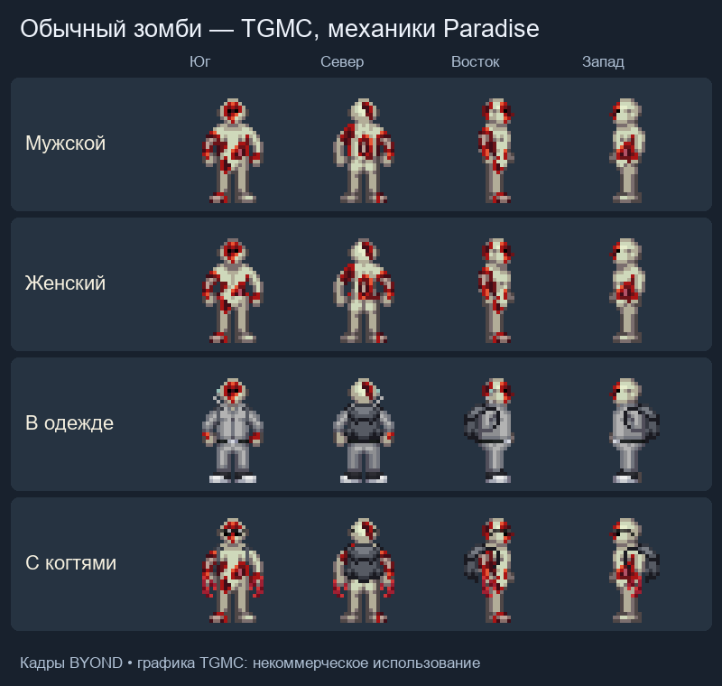
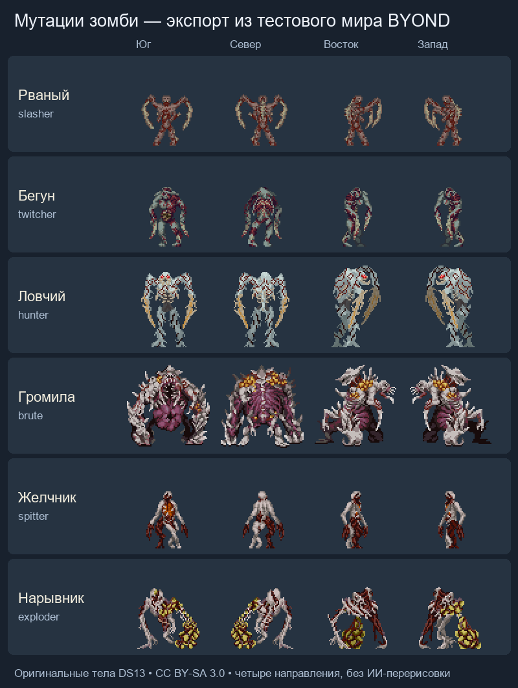

# Зомби Paradise SS220

Перенос с Paradise-SS220, commit [`0fffca1f1f29a63aff49d9b56524813eedf82c6d`](https://github.com/ss220club/Paradise-SS220/tree/0fffca1f1f29a63aff49d9b56524813eedf82c6d). Реализация заменяет прежнее заражение, опухоль и status effect TG; ромерол, бионекропластика, зомби-спавны и массовые админские команды используют одну новую систему.

Обычные зомби используют оригинальные светлые окровавленные тела TGMC: четыре направления, мужской и женский варианты, сохранённая одежда. Это замена отображения; инфекция, некроз, органы, лечение и оживление работают по перенесённым правилам Paradise. Особые мутации используют тела DS13. Графика TGMC сохраняет исходное ограничение некоммерческого использования; авторство и лицензионные записи исходного репозитория приведены в [icons/tgmc/README.md](icons/tgmc/README.md).

## Запуск

- `Fun → Zombie Control`: заразить выбранного персонажа, немедленно превратить или вылечить.
- `Mass Zombie Infection` / `Mass Zombie Cure`: заразить или вылечить текущий экипаж.
- Антагонист `Zombie` доступен в стандартной панели антагонистов.
- `Five Plague Talismans` в книге мага стоит одно очко и даёт пояс с пятью одноразовыми талисманами. Каждый поднимает умершего игрока в усиленного слугу с одной случайной болезнью из исходного пула тринадцати.

В исходнике это админское событие. Автоматический выбор первых заражённых и отдельные условия завершения раунда не добавлены. Руинные NPC сохраняют прежний запрет случайного заражения экипажа через поддерживаемый незаразный вариант; администратор может изменить его.

Кадры из игровых тестов BYOND: оба варианта тела, одежда и когти, четыре направления:

## Перенесённое поведение

Игровые тексты роли, целей, языка, заражения, лекарств, дополнительных болезней и талисманов переведены на русский. Сканеры и меню администратора показывают русские подписи. Названия видов в случайных штаммах Кингстона локализованы без изменения пула мутаций. Имена предметов используют словари склонений; общий двуручный хват показывает русские подсказки и сохраняет пользовательские переименования. Заклинательные формулы, псевдолатинские названия возбудителей и технические идентификаторы сохранены.

Семь стадий вируса, минутная инкубация и ускорение в мёртвом теле; последовательный некроз конечностей; когти, заражение царапинами, укусы из агрессивного захвата; вскрытие повреждённого черепа и поедание мозга; усиленная регенерация во тьме; многократное оживление после восстановления тела; действие Beta/Gamma/Omega; управление оставленным телом; язык, HUD, plague-когти и прыжок; хирургическое удаление опухоли.

Все зрелые зомби, включая особые формы, получают полное ночное зрение; лечение снимает его. Обычному зомби без выбранной формы доступен **«Голодный крик»**: на 10 секунд он ускоряет самого кричащего ровно на 10% и замедляет видимых живых незаражённых в пределах 5 клеток ровно на 10%. Перезарядка — 30 секунд. Повторные крики обновляют длительность замедления, но не складывают силу эффекта; заражённые, включая ещё не превратившихся, не замедляются. После выбора особой формы кнопка крика исчезает.

Alpha/Beta/Gamma/Omega используют реагенты TG и сохраняют прогресс ослабления штамма. Бета выбирает три ингредиента из семи. Гамма выбирает три из девяти — Egg Yolk, Sulfuric Acid, Fluorosulfuric Acid, Multiver, Leporazine, Mutadone, Spaceacillin, Mannitol и Oculine. Омега выбирает два из девяти. Для Gamma нужна заражённая кровь с симптомом разрушения плоти, для Omega — с симптомом регенерации. Sulfonal и сахар размножают имеющееся лекарство.

## Особые мутации

Это дополнительный дизайн поверх перенесённой чумы Paradise. Обычный зомби сохраняет физиологию расы и одежду, отображаясь телом TGMC. Кнопка **«Мутация чумы»** позволяет один раз выбрать специализацию; выбор закрепляется за разумом и сохраняется после лечения. Перестройка занимает шесть секунд: тело пульсирует и раздувается, а успешное превращение сопровождается кровавым всплеском в стиле Last Resort. Это только изображение и звук; оно не взрывает окружение и не повреждает тело. Во время перестройки можно двигаться. Смерть, перенос разума и лечение останавливают пульсацию; при отмене кровавого финала нет. Успешная мутация сбрасывает снаряжение на пол. Неснимаемые предметы и связывание мешают превращению. На мутированное тело нельзя надеть обычную одежду и наручники.

Все шесть высших форм не скользят и не падают от осколков; урон ногам от стекла сохраняется. При пожаре видны свободные языки пламени, при ударе током не появляется человеческий скелет; электрический урон сохраняется. Обычный зрелый зомби разрывает наручники через стандартное сопротивление за пять секунд. Квирк Cursed больше не отрывает конечности зрелого зомби при смерти. Лечение возвращает обычные ограничения тела.

| Форма | Роль | Открытие |
| --- | --- | --- |
| Рваный (Slasher) | Обычные когти, укусы, разрушение дверей ударами и притягивающий язык | 2 минуты, 1 зомби |
| Бегун (Twitcher) | Хрупкий, быстрый; отдельные рывок и таран до 12 клеток | 2 минуты, 1 зомби |
| Ловчий (Hunter) | Два прыжка до 10 клеток: сбивание или короткий захват; уязвимость после промаха | 10 минут, 4 зомби |
| Желчник (Puker) | Замедляющий и кислотный плевки до 13 клеток; слабые когти | 10 минут, 4 зомби |
| Нарывник (Exploder) | Взрыв желчи в радиусе 5 клеток и отдельный ослепляющий плевок; нарост можно прострелить | 10 минут, 4 зомби |
| Громила (Brute) | Медленный; 470 максимального здоровья при исходных 100, усиленные когти и выламывание стен | 20 минут, 8 зомби |

Время отсчитывается от первого обычного заражения персонажа с действующим разумом; руинные NPC и пустые трупы его не запускают. Популяция — текущие заражённые разумы в полностью превратившихся телах. Для всех форм, кроме Рваного, действует общий лимит: одно место на каждые четыре зомби, минимум одно. Громила дополнительно ограничен одним местом на восемь. Тело удерживает место после смерти и переноса разума, пока не будет вылечено или удалено. Уже полученные формы не исчезают при уменьшении популяции.

Пять дополнительных умений по мотивам особых заражённых L4D2 добавлены рядом с прежними: язык Рваного, таран Бегуна, захват Ловчего, кислотный плевок Желчника и ослепляющая желчь Нарывника. Старые рывок, прыжок, замедляющий плевок и взрыв остаются отдельными кнопками со своими перезарядками. Числа ниже — настройки этого режима.

| Форма и действие | Эффект | Перезарядка |
| --- | --- | --- |
| Рваный — «Хватательный язык» | Видимый выстрел до 8 клеток притягивает цель по свободному пути на соседнюю клетку. Тяга длится не более 2 секунд и не превращается в удержание. | 18 секунд |
| Бегун — «Рывок» | Перемещение до 12 клеток; стены и закрытые препятствия останавливают движение. | 8 секунд |
| Бегун — «Таран» | До 12 клеток до первой преграды; попадание наносит 20 физического урона до брони ближнего боя и прижимает жертву максимум на 2 секунды, без дополнительного периодического урона. | 20 секунд |
| Ловчий — «Прыжок из засады» | До 10 клеток; попадание выпущенными когтями сбивает на 1 секунду. После промаха Ловчий на 2 секунды замедляется и получает на 25% больше физического урона и ожогов. | 20 секунд |
| Ловчий — «Прыжок с захватом» | До 10 клеток; требует выпущенных когтей. После успешного удара когтями прижимает максимум на 4 секунды и наносит 3 физического урона в секунду до брони ближнего боя. Промах имеет ту же уязвимость, что и обычный прыжок. | 20 секунд |
| Желчник — «Желчный плевок» | Видимый снаряд до 13 клеток: 8 ожогового урона до BIO-защиты и одна смываемая лужа на 12 секунд. Контакт с лужей замедляет на 3 секунды; этот остаточный эффект может сохраняться после выхода. | 12 секунд |
| Желчник — «Кислотный плевок» | Тот же прямой удар до 13 клеток; смываемые лужи на 12 секунд покрывают доступные клетки в пределах одной клетки от попадания, максимум область 3×3. Они наносят стоящим в них противникам 4 ожогового урона в секунду до BIO-защиты. | 20 секунд |
| Нарывник — «Разрыв желчного узла» | Двухсекундная подготовка с возможностью двигаться; взрыв в радиусе 5 клеток. Нарост имеет 35 прочности; его разрушение срывает взрыв и наносит хозяину 40 физического урона. | 20 секунд |
| Нарывник — «Извергнуть желчь» | Видимый выстрел до 5 клеток без прямого урона закрывает зрение жертвы на 5 секунд. Желчь можно смыть с лица; полная BIO-защита блокирует ослепление. | 20 секунд |
| Громила — «Выломать стену» | Три этапа повреждения стены, как у Дракона: обычная стена занимает суммарно 4 секунды, укреплённая — 12. Можно двигаться, оставаясь рядом; отход, потеря сознания и лечение прерывают работу. Неразрушимые стены не поддаются, повреждения ремонтируются сваркой. | Без отдельной перезарядки |

Прижатая жертва не может двигаться и пользоваться руками, но может нажать **«Сопротивляться» (Resist)** и сразу освободиться. Помощь стоящего рядом союзника также снимает захват. Его срывают движение или отдаление захватчика, любой полученный им урон, оглушение, падение, смерть, лечение и перенос разума; смерть или перенос разума жертвы тоже освобождают её. После освобождения действует 2 секунды защиты от нового захвата и языка. Саму тягу языка также можно сорвать сопротивлением, попаданием по Рваному, потерей им сознания или появившейся преградой. Язык не притягивает закреплённые и пристёгнутые цели.

Когти учитывают ослабление от Beta перед множителем формы. У Громилы урон когтей умножается на 1,5, а двери, окна и баррикады дополнительно получают 60 урона за удар. Его максимальное здоровье увеличивается на 370; для обычного тела с исходными 100 это 470. Независимые модификаторы здоровья сохраняются при лечении. Дальняя желчь учитывает BIO-защиту и Alpha при заражении, не поражает союзных зомби. Несколько кислотных луж не складывают периодический урон: после выхода, уборки последней лужи или прекращения действия её источника ожоги прекращаются. Кислота не разъедает пол, стены и предметы.

Взрыв Нарывника наносит до учёта взрывной брони 60 физического урона в центре, на 6 меньше за каждую клетку, вплоть до 30 на расстоянии 5 клеток, и сбивает на 1 секунду. Он учитывает укрытия и убивает хозяина обычным способом, оставляя тело для последующего оживления; пол и стены не разрушает. Во время подготовки уязвимый нарост перемещается вместе с хозяином; новый появляется только при следующей подготовке. Смерть, лечение, перенос разума и снятие формы убирают принадлежащие способности снаряды, полёты, захваты, лужи и ослепление. Ранее полученное трёхсекундное замедление от обычной желчи заканчивается своим сроком; чужие эффекты при очистке не снимаются.

Все шесть форм используют собственные конечности DS13 для значков обеих рук и изображения ближней атаки. Рваный и Бегун бьют своими лезвиями, Громила — массивной лапой, Желчник — своей рукой, Нарывник — свободной правой рукой; его мешок остаётся на теле. У Ловчего используется отдельная оригинальная графика взмаха DS13. Во время удара соответствующая неподвижная рука временно скрывается. Это только графика: сохраняются двуручный хват, урон, заражение, действие Beta и удары при прыжке Paradise. Убирание когтей, лечение и изменение анатомии отменяют незавершённый взмах.

Когти разрушают закрытые двери обычными ударами, включая дополнительный урон Громилы по преградам. Вскрытия шлюзов по типу армблейда у зомби нет.

Десять классовых способностей и общие когти используют единый набор значков 32×32 с органической рамкой: [abilities.dmi](icons/abilities.dmi), [описание](icons/abilities.md). Когти имеют этот значок также у обычных и чумных зомби. Штатная дополнительная подложка для этих кнопок отключена, а индикация выбора, доступности и перезарядки сохраняется.

Мутация меняет отображение тела и боевые параметры. Настоящие конечности, органы, ДНК, раны и открытые операции сохраняются; лечение снимает форму и возвращает текущее тело, включая отсутствующие и пересаженные конечности. Кадры и направления DS13 сохранены в исходных DMI, живое тело собирается из состояний конечностей. Оригинальные ресурсы и лицензия указаны в [icons/mutations/LICENSE.md](icons/mutations/LICENSE.md).

Пороговые значения и боевые параметры — начальные настройки нового дизайна; баланс на живом сервере ещё не проверен.

Способности получили отдельные визуальные и звуковые сигналы. Крик расходится багровой волной; рывки и прыжки оставляют короткие послеобразы настоящего тела DS13, включая атакующую руку. Удары и захваты сопровождаются кровавыми всплесками, желчь — цветными брызгами, кислотные лужи пузырятся. При выламывании стены появляется пыль; желчный узел пульсирует перед органическим разрывом. Эти эффекты не меняют урон, дистанции, задержки, перезарядки и правила попадания.

Кнопки тарана, захвата, стены, кислоты, рвоты и подрыва различаются. Для языка, тарана и взрыва добавлены три неизменённых коротких звука DS13; источники и лицензия CC BY-SA 3.0 приведены в [sound/mutations/LICENSE.md](sound/mutations/LICENSE.md). Остальные сигналы используют штатные ресурсы билда. Длинный крик заменён коротким рыком, звук усилия Громилы больше не перекрывает следующие этапы работы; кислотное попадание звучит один раз, независимо от числа луж.

Обычный зомби и каждая из шести форм имеют отдельные звуки шагов и монструозные голоса для криков. Звуки принадлежат телу: остаются при уходе разума и возвращаются к обычным после лечения. Штатные правила слышимости, частота шагов, бесшумное движение и задержки эмоций сохраняются; ранее беззвучная смерть остаётся беззвучной. Источники записей DS13 перечислены в [лицензии шагов](sound/footsteps/ds13/LICENSE.md) и [лицензии голосов](sound/voices/LICENSE.md). Три записи шагов Громилы предоставлены пользователем; их происхождение пока не установлено, см. [локальное примечание](sound/footsteps/README.md).

Зомби доступны только «Крик», «Визг» и «Рёв». Прочие эмоции, включая произвольные `/me`, скрываются из панелей и блокируются на сервере; подмена текста крика также запрещена. Автоматическое предсмертное сообщение сохраняется. Лечение возвращает обычные эмоции и ранее скрытые избранные записи, не изменяя настройки игрока.

Полные кадры реальных bodypart-overlays из тестового мира BYOND, четыре направления:

## Совместимость движков

- Старые `external organs` представлены bodyparts и компонентом некроза; операция с чистым удалением конечности остаётся возможной, травматический отрыв вызывает перелом.
- Абстрактные когти, actions, сигналы и языковые блокировки используют текущие контракты TG; отдельного TG-зомби backend больше нет.
- Формула защиты когтей сохранена отдельно от обычного TG armor penetration, включая полное блокирование удара.
- Исследование использует рандомизированную химию TG и штатные реагенты. Strange Reagent участвует в пуле Омеги со своим обычным поведением TG.
- Сторонние расы, общая физиология и существующие препараты общего назначения остаются правилами этого билда. Неорганические тела не становятся обычными заразными зомби.
- Обычная зомби-инфекция сохраняет расу персонажа. Отдельная болезнь Advanced Kingston сохраняет случайную мутацию, используя доступные органические расы PrimeDream; отсутствующие дионы, киданы, драски, греи и скалки не добавлены.

## Авторство ресурсов

Код адаптирован из Paradise SS220 (AGPL/GPL согласно исходному репозиторию). Авторство механик и ресурсов принадлежит участникам Paradise SS220/ParadiseSS13 и исходным авторам.

Оригинальные ресурсы с указанного commit, лицензия CC BY-SA 3.0 согласно README исходника:

- `icons/antaghud.dmi`: состояние `hudzombie` из `icons/mob/hud/antaghud.dmi`.
- `icons/claws_lefthand.dmi`, `claws_righthand.dmi`: состояние `vamp_claws` из `icons/mob/inhands/weapons_lefthand.dmi` и `weapons_righthand.dmi`; кадры и DMI-метаданные сохранены.
- `sound/zomboidalert.ogg`: `sound/ambience/antag/zomboidalert.ogg`.
- `sound/zombie_leap.ogg`: `sound/voice/zombie_leap.ogg`.
- `sound/armblade.ogg`: `sound/weapons/armblade.ogg`.
- `icons/plague_talisman.dmi`: все восемь кадров состояния `plague_talisman` из `icons/obj/wizard.dmi`.
- `sound/mutate.ogg`: `sound/magic/mutate.ogg`.

Обычные когти и кнопка их выпуска повторно используют уже перенесённые ресурсы модуля `vampire`; значки рук и атаки шести мутаций используют ресурсы DS13, перечисленные выше. Звуки укуса и влажного удара — существующие ресурсы билда.
